# Grafana Dashboard & Prometheus Exporter for Apache NiFi 2 / Cloudera CFM 4

Apache NiFi 2.x 클러스터의 장애·병목을 감시하는 모니터링 구성입니다. 대상은 Cloudera Flow Management(CFM) 4.12에 포함된 **Apache NiFi 2.6.0**입니다.

| 구성 요소 | 위치 | 역할 |
|---|---|---|
| nifi-exporter | `exporter/` | NiFi REST API를 읽어 Prometheus 메트릭으로 노출 (Python 3.9+, Docker) |
| Provenance 조회 서비스 | `exporter/` (`nifi-provenance-query`) | Processor 하나와 시간 범위로 NiFi Provenance를 조회 (Grafana 링크에서 호출) |
| 알림 중계 서비스 | `exporter/` (`nifi-alert-relay`) | Alertmanager 알림을 사용자 정의 HTTP API로 다시 보냄 (대상별 본문 템플릿·필터·재시도) |
| Prometheus 설정·규칙 | `deploy/prometheus/` | 스크레이프 설정, recording rule 31개, alert rule 24개, 단위 테스트 |
| Alertmanager 설정 | `deploy/alertmanager/` | 라우팅, 억제(inhibit) 7종, Slack 템플릿 |
| Grafana 대시보드 | `deploy/grafana/` | 대시보드 6종과 provisioning 파일 (생성기로 관리) |
| 로컬 검증 스택 | `deploy/local/` | NiFi 2.6.0 2노드 클러스터 + 위 구성 전체 (Docker Compose) |
| CFM 구성 | `deploy/cfm/` | 대상 CFM 클러스터용 exporter·Provenance 조회·Prometheus 설정 (주소는 커밋하지 않는 `.env`) |
| 운영 문서 | `docs/runbook.md` | 알림별 대응 절차 |

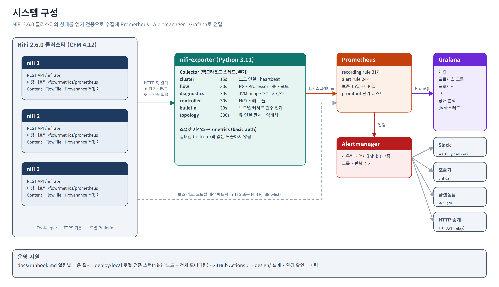

> 처음 설치하거나 Docker를 쓸 수 없는 서버라면 [INSTALL.md](INSTALL.md)를 따라 하세요. Python venv와 systemd로 한 단계씩 설치하고, 단계마다 확인 방법을 적었습니다.

## 목차

1. [기능](#1-기능)
2. [요구사항](#2-요구사항)
3. [빠른 시작 (로컬)](#3-빠른-시작-로컬)
4. [설치](#4-설치)
5. [설정 참조](#5-설정-참조)
6. [메트릭](#6-메트릭)
7. [알림](#7-알림)
8. [대시보드](#8-대시보드)
9. [운영](#9-운영)
10. [개발과 테스트](#10-개발과-테스트)
11. [저장소 구조와 관련 문서](#11-저장소-구조와-관련-문서)
12. [라이선스](#12-라이선스)

---

## 1. 기능

### 수집 (nifi-exporter)

Prometheus에 metric 정보를 제공하는 서비스를 exporter라고 부릅니다. nifi-exporter는 nifi에서 정보를 수집해서 prometheus가 정보를 가져갈 수 있도록 HTTP 서비스를 제공합니다.

| 영역 | 기능 |
|---|---|
| 클러스터 | 노드 수·연결 수, 노드별 상태(CONNECTED/DISCONNECTED/OFFLOADED…)·역할, heartbeat 경과 시간, 노드별 스레드·적체. 단일 노드(비클러스터) NiFi는 자동으로 알아봅니다(`nifi_cluster_clustered` 0) |
| Process Group | 계층 경로(`/ingest/errors`), 적체 수·바이트, 스레드, 5분 입출력·처리 시간, 상태별 Processor 수 |
| Processor | 실행 상태(Running/Stopped/Invalid/Disabled), 스레드·강제 종료 스레드, 5분 task 수·시간, 입출력·읽기·쓰기 바이트 |
| Connection(큐) | 적체 수·바이트, Backpressure 사용률(개수·바이트), 5분 입출력, source/destination id·종류, Backpressure 임계치 |
| 포트·RPG | 입력/출력 포트 상태·전송 여부·입출력, Remote Process Group 전송 상태·송수신량 |
| JVM·시스템 | 노드별 heap(사용·확보·최대)·non-heap(사용·확보), JVM 스레드(전체·daemon), GC 횟수·시간, JVM 가동 시간, load average, CPU 수 |
| NiFi 스레드 풀 | timer-driven 스레드 풀 크기(`maxTimerDrivenThreadCount`), 활성·강제 종료 스레드, 노드별 사용률(recording rule) |
| 저장소 | 노드별 Content·FlowFile·Provenance 저장소 사용률·여유 공간 |
| Bulletin | 레벨·Process Group·source별 누적 건수(노드별 id 커서로 중복 없이), 원문 JSON 로그 출력(선택) |
| 인증 | mTLS 클라이언트 인증서, JWT(Single User/LDAP, 만료 5분 전 자동 재발급, 401 시 재로그인), 또는 인증 없음. TLS·인증 없는 HTTP NiFi도 수집합니다 |
| 보호 | `/metrics` basic auth, 프로브용 `/healthz`·`/readyz` |
| 안정성 | collector별 독립 스레드·주기·타임아웃, 재시도, 동시 호출 제한. 실패한 collector의 값은 노출하지 않고 성공 여부로 표시하며, 주기가 길어도 30초 뒤 다시 시도 |
| 자체 감시 | collector 성공·소요 시간·주기, API 호출 수·응답 크기, 토큰 만료 시각 |

### 알림 · 대시보드 · 운영 도구

| 영역 | 기능 |
|---|---|
| 알림 | 24종: 수집 장애, 노드 단절·heartbeat·과반 상실, heap·GC·스레드 풀·저장소, 큐 80%·발동·증가·정체, Processor Invalid·강제 종료·지연, ERROR Bulletin, 알림 중계 장애 ([7장](#7-알림)) |
| 수신처 | Slack, 메일, 호출기 webhook, 그리고 `nifi-alert-relay`를 거친 사용자 정의 HTTP API ([4.7](#47-알림-중계-서비스-선택)) |
| 억제 | 원인 알림이 결과 알림을 억제(7종). 수집 장애 시 잘못된 "해소" 통지 방지(`keep_firing_for`) |
| 대시보드 | 개요, 프로세스 그룹, 프로세서, 큐, 장애 분석, JVM·스레드 ([8장](#8-대시보드)) |
| Provenance 조회 | 장애 분석 그래프의 점이나 프로세서 표의 이름을 클릭하면 그 Processor의 Provenance 이벤트(종류·시각·노드·FlowFile UUID)를 5분 범위로 조회. Processor ID와 시간 범위를 강제하고 범위·결과 수·동시 조회 수를 제한하며, 질의는 항상 NiFi에서 지움 ([4.6](#46-provenance-조회-서비스-선택)) |
| 검증 도구 | 수치 대조(`compare.py`), 장애 시나리오 6종(`scenarios.py`), API 응답 수집(`capture_samples.py`), 대시보드 쿼리 검사(`check_dashboards.py`), 링크 클릭 검사(`check_drilldown.py`) |

## 2. 요구사항

| 항목 | 요구사항 |
|---|---|
| NiFi | Apache NiFi 2.6.0 (CFM 4.12.0, 빌드 `2.6.0.4.12.0.x`). 다른 2.x는 [9.4](#94-nifi-업그레이드)의 절차로 응답을 확인한 뒤 사용 |
| NiFi 계정 | 읽기 전용 계정(예: `nifi-monitor`). [4.1](#41-nifi-계정과-권한) 참조 |
| exporter | Docker, 또는 Python 3.9 이상 |
| Prometheus | 2.42 이상 (`keep_firing_for` 사용). 검증 버전 2.53.4 |
| Alertmanager | 검증 버전 0.28.1 |
| Grafana | 11.6 이상 (11.3에서는 같은 대시보드로 가는 드릴다운 링크가 30초 새로고침 때까지 반영되지 않음). 검증 버전 11.6.0 |
| 시간대 | 모니터링 서버 OS, NiFi 서버·JVM, exporter `nifi.timezone`, Grafana 대시보드를 모두 **`Asia/Seoul`(KST)**로 통일. Prometheus·Alertmanager는 내부적으로 항상 UTC로 저장하며 화면에서만 KST로 봅니다. 상세: [INSTALL.md 1.6](INSTALL.md#16-시간대를-asiaseoul로-고정) |
| 네트워크 | exporter → NiFi HTTPS 또는 HTTP. Prometheus → exporter `:9103`. (선택) Prometheus → 각 NiFi 노드 HTTPS 또는 HTTP |

## 3. 빠른 시작 (로컬)

NiFi 2.6.0 2노드 클러스터와 모니터링 전체를 로컬에서 실행합니다. Docker와 Docker Compose가 필요합니다.

```bash
git clone https://github.com/DataDynamics-OSS/nifi-monitoring.git
cd nifi-monitoring/deploy/local
./gen-certs.sh              # 테스트용 CA·인증서·비밀값 생성
docker compose up -d        # NiFi 2노드 연결까지 약 1분
python3 seed.py             # 테스트 플로우, 읽기 전용 계정, Provenance 조회 계정 생성
python3 compare.py          # NiFi API 값과 Prometheus 값 대조
```

| 서비스 | 주소 | 로그인 |
|---|---|---|
| Grafana | http://localhost:13000 | `admin` / `localtest` |
| Prometheus | http://localhost:19090 | |
| Alertmanager | http://localhost:19093 | |
| nifi-exporter | http://localhost:19103/metrics | `prometheus` / `localtest` |
| Provenance 조회 | http://localhost:19104 | |
| 알림 중계 / 시험 수신처 | http://localhost:19107/metrics, http://localhost:19108/requests | `alertmanager` / `localtest` (중계) |
| NiFi | https://localhost:18443/nifi | 브라우저에 `certs/admin.p12` 등록 (비밀번호 `localtest`) |

테스트 플로우가 큐 적체, Invalid Processor, ERROR Bulletin, 소비 정체를 일부러 만들므로 몇 분 뒤 알림이 발화합니다. 상세: [deploy/local/README.md](deploy/local/README.md).

TLS·인증이 없는 단일 노드 NiFi에 붙이는 경우도 같은 디렉터리에서 확인할 수 있습니다.

```bash
docker compose --profile plain up -d nifi-plain nifi-exporter-plain
# NiFi http://localhost:18090/nifi (인증 없음), exporter http://localhost:19105/metrics
```

## 4. 설치

이 장은 설치 요점입니다. 명령은 저장소 루트(`git clone https://github.com/DataDynamics-OSS/nifi-monitoring.git`로 받은 `nifi-monitoring/`)에서 시작합니다. 인터넷이 안 되는 서버는 다른 PC에서 받아 압축해 복사합니다. Docker 없이 처음부터 따라 하는 설치 절차(systemd 등록, 폐쇄망, 문제 해결 포함)는 [INSTALL.md](INSTALL.md)에 있습니다. pip·venv 없이 압축 하나를 풀어 `bin/start.sh`로 실행하는 묶음(`make dist`)은 [INSTALL.md 3.5](INSTALL.md#35-대안-설치-없이-스크립트로-실행)를 봅니다.

### 4.1 NiFi 계정과 권한

NiFi UI의 Users·Policies에서 exporter용 계정을 만들고 다음 정책을 **view** 권한으로 줍니다. NiFi 2.6.0에서 이 4개만으로 모든 수집 엔드포인트가 동작하는 것을 확인했습니다.

| 정책 | 용도 |
|---|---|
| `/flow` (view the user interface) | 플로우 상태, Bulletin, 내장 메트릭 |
| `/controller` (access the controller) | 클러스터 노드 상태 |
| `/system` (view system diagnostics) | JVM·저장소 |
| 루트 Process Group (view the component) | 하위 컴포넌트 상태 (상속) |

- mTLS를 쓰면 인증서의 DN(예: `CN=nifi-monitor`)을 사용자로 등록합니다.
- exporter가 부르는 호스트명이 NiFi 노드 이름과 다르면(LB 등) `nifi.web.proxy.host`에 추가합니다. 없으면 `400 Invalid host header`가 납니다.

### 4.2 nifi-exporter

```bash
cd exporter
docker build -t nifi-exporter:0.1.0 .
cp config/nifi-exporter.example.yaml /etc/nifi-exporter/config.yaml   # 편집
nifi-exporter --check-config -c /etc/nifi-exporter/config.yaml          # 설정 검증 (Python 설치 시)

docker run -d --name nifi-exporter -p 9103:9103 \
  -v /etc/nifi-exporter:/etc/nifi-exporter:ro \
  nifi-exporter:0.1.0
```

- 이미지는 비root(uid 65534)로 실행하고 기본으로 `/etc/nifi-exporter/config.yaml`을 읽습니다.
- **클러스터당 exporter 1개**만 운영합니다. 가용성은 재시작하는 실행 환경(systemd `Restart=always`, Kubernetes `replicas: 1`)으로 확보합니다. 2개를 동시에 스크레이프하면 알림 조인이 모두 실패합니다([9.2](#92-exporter-가용성)).
- 단일 노드(비클러스터) NiFi도 설정을 바꿀 필요가 없습니다. `cluster` collector가 `/controller/cluster`의 404를 받으면 `/flow/cluster/summary`로 단일 노드인지 확인하고, 단일 노드이면 실패로 보고하지 않고 `nifi_cluster_clustered` 0만 냅니다.
- TLS·인증이 없는 NiFi(HTTP)는 `nifi.base_url: http://...`, `nifi.auth.mode: none`으로 설정합니다([5.1](#51-exporter-설정-파일)).

Python으로 직접 실행하려면:

```bash
cd exporter && make venv install
.venv/bin/python -m nifi_exporter --config /etc/nifi-exporter/config.yaml
```

### 4.3 Prometheus

`deploy/prometheus/prometheus.yml`과 `rules/`를 Prometheus 설정 디렉터리에 둡니다. 다음 값을 환경에 맞게 바꿉니다. 대상 CFM 클러스터의 실값판은 [deploy/cfm/](deploy/cfm/README.md)에 있습니다(HTTP·인증 없음, 내장 엔드포인트 job 없음).

| 위치 | 바꿀 값 |
|---|---|
| `nifi-exporter` job | 대상 주소, `cluster` 레이블(= exporter의 `nifi.cluster_name`), `basic_auth.password_file` |
| `nifi-builtin` job (선택) | 각 NiFi 노드 주소, mTLS 인증서 경로. 노드별 분해가 필요 없으면 job 삭제 |
| `node` job (선택) | node_exporter 주소 |
| `alerting` | Alertmanager 주소 |

```bash
promtool check config prometheus.yml        # 파일 경로까지 확인
promtool check rules rules/*.yml
promtool test rules tests/*_test.yml
```

보존 기간은 `--storage.tsdb.retention.time=15d`(안정화 후 30d)로 시작합니다. 용량 산정은 [9.5](#95-규모-산정)를 참고합니다.

### 4.4 Alertmanager

`deploy/alertmanager/alertmanager.yml`과 `templates/`를 배치하고 다음을 채웁니다.

| 항목 | 위치 |
|---|---|
| Slack 웹훅 | `/etc/alertmanager/slack_webhook` 파일, 채널명 |
| 메일 | `smtp_*` 설정, `/etc/alertmanager/smtp_password` 파일 |
| 호출기 | `ops-pager` 수신처의 webhook URL |
| 사용자 정의 HTTP | `custom-relay` 수신처의 중계 주소, `/etc/alertmanager/alert_relay_password` 파일 ([4.7](#47-알림-중계-서비스-선택)) |

```bash
amtool check-config alertmanager.yml
```

### 4.5 Grafana

`deploy/grafana/provisioning/`을 `/etc/grafana/provisioning`에, `deploy/grafana/dashboards/`를 `/var/lib/grafana/dashboards/nifi`에 마운트하고 환경변수 `PROMETHEUS_URL`을 설정합니다. 대시보드는 **NiFi** 폴더에 읽기 전용으로 올라갑니다. 수정 방법은 [deploy/grafana/README.md](deploy/grafana/README.md).

대시보드 시간대는 기본이 사용자 브라우저 기준(`browser`)입니다. `Asia/Seoul`로 고정하려면 복사한 JSON을 바꿉니다([INSTALL.md 6.2](INSTALL.md#62-데이터소스와-대시보드-넣기)).

```bash
sed -i 's/"timezone": "browser"/"timezone": "Asia\/Seoul"/' /var/lib/grafana/dashboards/nifi/*.json
```

### 4.6 Provenance 조회 서비스 (선택)

`nifi-provenance-query`는 exporter와 같은 이미지·설정 형식을 쓰는 별도 프로세스입니다. Grafana 링크가 `processor_id`와 시각을 넘기면 NiFi에 Provenance 질의를 만들고(`POST /provenance`), 끝날 때까지 폴링한 뒤(`GET /provenance/{id}`), 결과를 HTML 표(또는 `format=json`)로 돌려주고 질의를 지웁니다(`DELETE /provenance/{id}`, 실패·타임아웃 때도).

1. NiFi에 조회용 계정을 따로 만들고 다음 정책을 줍니다. exporter 계정에는 주지 않습니다.

   | 정책 | 용도 |
   |---|---|
   | `/provenance` (query provenance) | 질의 실행 |
   | 루트 Process Group (view provenance) | 이벤트 보기 (상속) |
   | 루트 Process Group (view the component) | 이벤트의 컴포넌트 이름. 없으면 이름 대신 id가 나옵니다 |

   데이터 보기(view the data) 권한은 필요 없습니다. 속성과 내용은 요청하지 않습니다. 2.6.0 클러스터에서는 노드 identity에 Provenance 보기 권한이 없어도 모든 노드의 이벤트가 조회되는 것을 확인했습니다.

2. 설정 파일에 `nifi`(조회용 계정)와 `provenance` 절을 씁니다([5.1](#51-exporter-설정-파일)). 예: [deploy/local/provenance-query.yaml](deploy/local/provenance-query.yaml).

   ```bash
   docker run -d --name nifi-provenance-query -p 9104:9104 \
     -v /etc/nifi-provenance-query:/etc/nifi-exporter:ro \
     --entrypoint nifi-provenance-query nifi-exporter:0.1.0 --config /etc/nifi-exporter/config.yaml
   ```

3. 대시보드 링크가 이 서비스 주소를 쓰도록 생성합니다. 주소는 Grafana 서버가 아니라 **사용자 브라우저**에서 닿아야 합니다.

   ```bash
   NIFI_PROVENANCE_URL=https://nifi-provenance.example.com python3 deploy/grafana/build_dashboards.py
   ```

서비스 하나가 클러스터 하나를 조회합니다. 링크는 `cluster`를 함께 넘기고, 서비스는 자신의 `nifi.cluster_name`과 다르면 거절합니다.

### 4.7 알림 중계 서비스 (선택)

Slack·메일 외에 사내 당직·티켓·문자 시스템처럼 고유 형식의 HTTP API로 알림을 보낼 때 씁니다. `nifi-alert-relay`는 exporter와 같은 이미지의 세 번째 진입점입니다. Alertmanager의 `custom-relay` 수신처(webhook)가 모든 알림을 이 서비스로 보내고, 서비스는 설정한 대상마다 다음을 적용해 다시 보냅니다.

| 대상 설정 | 내용 |
|---|---|
| `url`, `method`, `headers` | 대상 API. 헤더 값의 `${ENV}`는 시작할 때 환경변수로 바꿉니다(토큰을 설정 파일에 두지 않습니다) |
| `mode` | `alert`: 알림 하나에 요청 하나 / `group`: Alertmanager 통지 하나에 요청 하나 |
| `payload` | 생략하면 Alertmanager 본문(또는 알림 하나)을 그대로 보냅니다. 지정하면 그 JSON 구조에서 `{alertname}`, `{summary}`, `{labels[pg_id]}` 같은 자리를 채웁니다 |
| `match`, `send_resolved` | 레이블·`status` 값으로 보낼 알림을 고릅니다 |
| `timeout`, `retries`, `retry_backoff`, `tls` | 5xx·429·연결 오류만 재시도합니다. 4xx는 바로 실패입니다 |

- 대상 하나라도 실패하면 Alertmanager에 502를 돌려주어 통지를 다시 받습니다. 이미 성공한 대상은 `dedupe_window`(기본 5분) 동안 다시 보내지 않습니다.
- 전송 결과는 `/metrics`(`nifi_alert_relay_deliveries_total{target,result}`)로 나가고, Prometheus의 `nifi-alert-relay` job과 알림 `NiFiAlertRelayDown`·`NiFiAlertRelayFailing`이 감시합니다. 이 알림은 Slack으로도 가므로 중계가 멈춰도 알 수 있습니다.

```bash
docker run -d --name nifi-alert-relay -p 9105:9105 -e OPS_API_TOKEN=... \
  -v /etc/nifi-alert-relay:/etc/nifi-alert-relay:ro \
  --entrypoint nifi-alert-relay nifi-exporter:0.1.0 --config /etc/nifi-alert-relay/config.yaml
```

설정 예시: [exporter/config/nifi-alert-relay.example.yaml](exporter/config/nifi-alert-relay.example.yaml). 로컬 스택은 시험 수신처(`alert-sink`)로 보냅니다(`deploy/local/alert-relay.yaml`).

## 5. 설정 참조

### 5.1 exporter 설정 파일

예시: [exporter/config/nifi-exporter.example.yaml](exporter/config/nifi-exporter.example.yaml). 기간 값은 `15s`, `5m`, `250ms`, 숫자(초)를 받습니다.

| 키 | 기본값 | 설명 |
|---|---|---|
| `nifi.base_url` | `https://localhost:8443` | 클러스터 노드 하나 또는 LB 주소. `http://` 또는 `https://`만 받습니다 |
| `nifi.cluster_name` | `nifi` | 모든 메트릭의 `cluster` 레이블 |
| `nifi.timezone` | `UTC` | NiFi 서버 시간대(IANA). heartbeat 시각 해석용. **`Asia/Seoul`로 통일합니다**(예시 설정의 값). NiFi가 아직 KST가 아니면 바꿀 때까지만 실제 시간대(`/flow/about`의 `timezone`이 `EDT`면 `America/New_York`)를 넣습니다. 틀리면 heartbeat 경과가 시차만큼 어긋나 `NiFiNodeHeartbeatStale`이 잘못 발화합니다 |
| `nifi.timeout` | `10s` | 요청 타임아웃 |
| `nifi.max_concurrency` | `4` | NiFi 동시 요청 수 상한 |
| `nifi.retries` / `retry_backoff` | `1` / `2s` | 전송 오류·5xx 재시도 |
| `nifi.tls.ca_file` | | NiFi 서버 인증서의 CA 번들 |
| `nifi.tls.insecure_skip_verify` | `false` | 인증서 검증 끔 (테스트 전용) |
| `nifi.auth.mode` | `bearer` | `bearer` \| `mtls` \| `none`. `http://` 주소에는 `none`만 허용합니다(NiFi는 HTTPS에서만 토큰을 발급하고, mtls는 TLS가 필요합니다) |
| `nifi.auth.username` / `password` / `password_file` | | bearer 계정 |
| `nifi.auth.cert_file` / `key_file` | | mtls 클라이언트 인증서 |
| `nifi.auth.refresh_margin` | `5m` | JWT 만료 전 재발급 여유 |
| `collectors.<name>.enabled` | `true` | `cluster`, `flow`, `diagnostics`, `bulletin`, `controller`, `topology` |
| `collectors.<name>.interval` | 15s / 30s / 30s / 30s / 30s / 300s | 수집 주기. 실패하면 주기가 길어도 30초 뒤 다시 시도합니다 |
| `collectors.flow.exclude_pg_ids` | `[]` | 수집에서 뺄 Process Group id (`topology`도 동일 키) |
| `collectors.bulletin.limit` | `1000` | 요청당 노드별 최대 Bulletin 수 |
| `server.listen` | `0.0.0.0:9103` | HTTP 주소 |
| `server.log_level` / `log_format` | `INFO` / `json` | `json` \| `text` |
| `server.log_bulletin_messages` | `false` | Bulletin 원문을 exporter의 JSON 로그로 출력 |
| `server.log_file` / `log_max_size` / `log_backups` | 없음(stdout) / `50MB` / `5` | 로그 파일 경로(상대 경로는 실행 디렉토리 기준). 크기를 넘으면 `.1` ~ `.N`으로 돌립니다 |
| `server.basic_auth.username` / `password` / `password_file` | | `/metrics` 보호. Provenance 조회 서비스에서는 `/healthz`를 뺀 모든 경로 보호 |
| `provenance.listen` | `0.0.0.0:9104` | Provenance 조회 서비스 HTTP 주소 (exporter는 `provenance` 절을 쓰지 않습니다) |
| `provenance.max_range` | `1h` | 최대 조회 범위. 넘으면 끝 시각 기준으로 줄이고 화면에 알립니다 |
| `provenance.default_window` | `5m` | `at`만 받았을 때 조회하는 범위 `[at - window, at]` |
| `provenance.max_results` | `1000` | NiFi에 요청하는 최대 이벤트 수(요청값의 상한, 최대 10000) |
| `provenance.query_timeout` / `poll_interval` | `60s` / `1s` | 질의 완료 대기 시간과 폴링 간격. 시간을 넘기면 504를 돌려주고 질의를 지웁니다 |
| `provenance.max_concurrent` | `2` | 동시 조회 수. 넘으면 429로 거절합니다 |

### 5.2 환경변수와 CLI

| 환경변수 | 덮어쓰는 값 |
|---|---|
| `NIFI_BASE_URL` | `nifi.base_url` |
| `NIFI_USERNAME` / `NIFI_PASSWORD` | `nifi.auth.username` / `password` |
| `NIFI_EXPORTER_LISTEN` | `server.listen` |
| `NIFI_EXPORTER_LOG_LEVEL` | `server.log_level` |
| `NIFI_EXPORTER_BASIC_AUTH_PASSWORD` | `server.basic_auth.password` |
| `NIFI_PROVENANCE_LISTEN` | `provenance.listen` |

```text
nifi-exporter [-c CONFIG] [--check-config] [--version]
nifi-provenance-query [-c CONFIG] [--check-config] [--version]
nifi-alert-relay -c CONFIG [--check-config] [--version]
```

알림 중계 서비스의 환경변수: `NIFI_ALERT_RELAY_LISTEN`(listen), `NIFI_ALERT_RELAY_PASSWORD`(basic auth 비밀번호), 그리고 대상 `url`·`headers`에 쓴 `${ENV}`.

### 5.3 HTTP 엔드포인트

| 경로 | 인증 | 내용 |
|---|---|---|
| `/metrics` | basic auth (설정 시) | 최근 수집 스냅샷. NiFi를 호출하지 않음 |
| `/healthz` | 없음 | 프로세스 동작 여부 (항상 200) |
| `/readyz` | 없음 | collector가 한 번이라도 성공하면 200, 아니면 503 |

Provenance 조회 서비스:

| 경로 | 인증 | 내용 |
|---|---|---|
| `/provenance?processor_id=<UUID>&at=<시각>[&window=5m]` | basic auth (설정 시) | `[at - window, at]` 조회. 시각은 epoch 밀리초(Grafana `${__value.time}`) 또는 ISO 8601 |
| `/provenance?processor_id=<UUID>&from=<시각>&to=<시각>` | 같음 | 범위 조회 (`max_range`까지) |
| 선택 매개변수 | | `cluster`(다르면 400), `max_results`, `format=json` |
| `/healthz` | 없음 | 항상 200 |

`processor_id`나 시간 범위가 없으면 400, NiFi 권한이 없으면 502(필요한 권한을 안내), 시간 초과는 504, 동시 조회 초과는 429입니다.

## 6. 메트릭

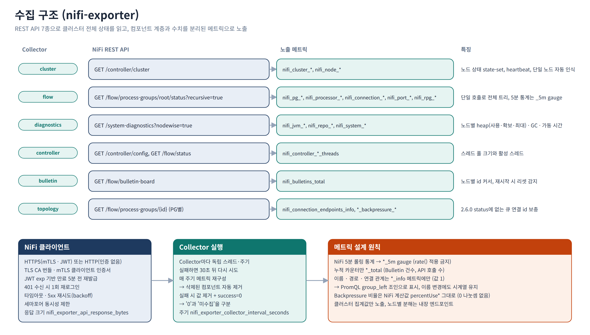

| collector | NiFi API | 주요 메트릭 (접두사 `nifi_`) |
|---|---|---|
| `cluster` | `GET /controller/cluster` (404면 `GET /flow/cluster/summary`) | `cluster_clustered`, `cluster_nodes_total`, `cluster_nodes_connected`, `node_info`, `node_status`, `node_heartbeat_age_seconds`, `node_active_threads`, `node_queued_*` |
| `flow` | `GET /flow/process-groups/root/status?recursive=true` | `pg_*`, `processor_*`, `connection_*`, `port_*`, `rpg_*` |
| `diagnostics` | `GET /system-diagnostics?nodewise=true` | `jvm_heap_{used,committed,max}_bytes`, `jvm_heap_utilization`, `jvm_nonheap_{used,committed}_bytes`, `jvm_threads`, `jvm_daemon_threads`, `jvm_gc_*_total`, `jvm_uptime_seconds`, `repo_*`, `system_*` |
| `controller` | `GET /controller/config`, `GET /flow/status` | `controller_max_timer_driven_threads`, `controller_active_threads`, `controller_terminated_threads` |
| `bulletin` | `GET /flow/bulletin-board` | `bulletins_total`, `bulletins_observed_5m`, `bulletin_last_timestamp_seconds` |
| `topology` | `GET /flow/process-groups/{id}` (그룹별) | `connection_endpoints_info`, `connection_backpressure_*_threshold` |
| (자체) | | `nifi_exporter_collector_success`, `_duration_seconds`, `_interval_seconds`, `_last_success_timestamp_seconds`, `nifi_exporter_api_requests_total`, `nifi_exporter_api_response_bytes`, `nifi_exporter_token_expiry_timestamp_seconds` |

메트릭 규칙:

- `*_5m`: NiFi의 5분 롤링 통계(gauge). `rate()`/`increase()`를 적용하지 않습니다.
- `*_total`: exporter가 누적하는 카운터(Bulletin 건수, API 호출 수)만 해당합니다.
- 이름·경로·연결 관계는 `*_info` 메트릭(값 1)에만 둡니다. 표시할 때는 조인합니다.

  ```promql
  nifi_pg_queued_flowfiles * on (cluster, pg_id) group_left (pg_path) nifi_pg_info
  ```

- collector가 실패하면 그 메트릭은 노출되지 않고 `nifi_exporter_collector_success`가 0이 됩니다. 값이 없는 것은 "0"이 아니라 "미수집"입니다.
- NiFi 2.6.0 상태 응답에는 큐의 source/destination id가 없습니다. 그래서 `topology` collector가 5분마다 보충하며, 이 값이 있어야 `NiFiQueueStalled`가 동작합니다.
- Bulletin 건수는 하한값입니다. NiFi가 컴포넌트당 최근 5건만 약 5분 보관하기 때문입니다.

전체 목록과 레이블: [exporter/README.md](exporter/README.md). recording rule 목록: `deploy/prometheus/rules/nifi-recording.yml`.

## 7. 알림

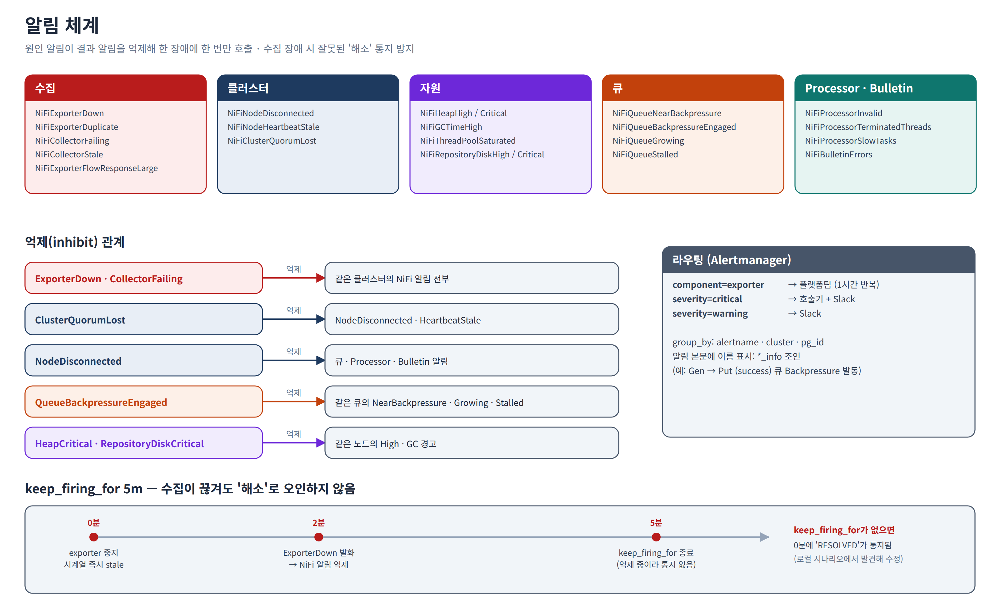

| 알림 | 심각도 | 조건 (초기값) |
|---|---|---|
| `NiFiExporterDown` | critical | exporter 스크레이프 실패 2분 |
| `NiFiExporterDuplicate` | critical | 한 클러스터에 exporter 2개 이상 |
| `NiFiCollectorFailing` | critical | collector 실패 3분 |
| `NiFiCollectorStale` | warning | 마지막 성공 후 주기의 3배(최소 3분) |
| `NiFiExporterFlowResponseLarge` | warning | flow 응답 10MB 초과 30분 |
| `NiFiNodeDisconnected` | critical | 노드가 CONNECTED가 아님 2분 |
| `NiFiNodeHeartbeatStale` | warning | heartbeat 60초 초과 |
| `NiFiClusterQuorumLost` | critical | 연결 노드가 과반 미만 |
| `NiFiHeapHigh` / `NiFiHeapCritical` | warning / critical | heap 85% 10분 / 95% 3분 |
| `NiFiGCTimeHigh` | warning | GC 시간 비율 20% 10분 |
| `NiFiThreadPoolSaturated` | warning | 노드의 timer-driven 스레드 풀 사용률 90% 이상 10분 |
| `NiFiRepositoryDiskHigh` / `Critical` | warning / critical | 저장소 80% 10분 / 92% 2분 |
| `NiFiQueueNearBackpressure` | warning | Backpressure 80% 초과 5분 |
| `NiFiQueueBackpressureEngaged` | critical | Backpressure 100% 5분 |
| `NiFiQueueGrowing` | warning | 10분간 1,000개 이상 증가 |
| `NiFiQueueStalled` | warning | 하류 Processor가 Running인데 소비 0, 10분 |
| `NiFiProcessorInvalid` | warning | Invalid 5분 |
| `NiFiProcessorTerminatedThreads` | warning | 강제 종료 스레드 존재 5분 |
| `NiFiProcessorSlowTasks` | warning | 평균 task 30초 초과 10분 |
| `NiFiBulletinErrors` | warning | 한 source에서 5분간 ERROR 10건 초과 |
| `NiFiAlertRelayDown` | warning | 알림 중계 서비스 스크레이프 실패 5분 |
| `NiFiAlertRelayFailing` | warning | 최근 15분에 재시도까지 실패한 중계 전송이 있음 |

- **억제**: 원인 알림이 결과 알림을 억제합니다. 수집 장애 → 같은 클러스터의 NiFi 알림 전체, 과반 상실 → 노드 알림, 노드 단절 → 큐·Processor·Bulletin 알림, Backpressure 발동 → 같은 큐의 80%·증가·정체, heap·저장소 critical → 같은 노드의 warning, collector 실패 → 같은 collector의 지연입니다.
- **라우팅**: 모든 알림을 먼저 알림 중계(`custom-relay`)로 보내고(대상별 필터는 중계 설정), 이어서 `component=exporter`는 플랫폼팀으로, critical은 호출기와 Slack으로, warning은 Slack으로 보냅니다.
- **`keep_firing_for: 5m`**: NiFi 상태 알림은 조건이 사라진 뒤에도 5분간 유지됩니다. 수집이 끊긴 순간 "RESOLVED"가 잘못 나가지 않게 하기 위해서입니다. 실제 해소 통지도 최대 5분 늦어집니다.
- 임계치는 초기값입니다. 운영 2주 데이터로 조정하고 [docs/runbook.md](docs/runbook.md)에 기록합니다.

## 8. 대시보드

| 대시보드 | 내용 |
|---|---|
| NiFi / 개요 | 수집 상태, 연결 노드 수, Invalid Processor, 80% 초과 큐, Backpressure 발동, ERROR Bulletin, 노드 표(상태·heartbeat·스레드·적체·heap·저장소·스레드 풀·가동 시간), heap·저장소, 적체 추이, 발화 중인 알림 |
| NiFi / 프로세스 그룹 | 선택 그룹과 하위 그룹 표(경로·적체·Δ10m·스레드·입출력·상태별 Processor 수). 경로 클릭으로 하위 이동 |
| NiFi / 프로세서 | 상태·스레드·평균 task 시간·입출력·ERROR Bulletin 표, Processor별 추이 |
| NiFi / 큐 | Backpressure 사용률 순 큐 표(Δ5m·Δ10m·임계치·하류 Running 여부), 큐별 추이 |
| NiFi / 장애 분석 | 알림 발화 시점 표시, Processor별 ERROR, 빨리 쌓이는 큐, 느린 Processor, 노드·heap·GC 추이 |
| NiFi / JVM·스레드 | 스레드 풀 크기·활성·강제 종료·최대 사용률, 노드별 스레드 풀 사용률, 활성 스레드와 풀 크기, JVM 스레드 수(전체·daemon), JVM 가동 시간, Heap 사용·확보·최대와 사용률, Non-heap, GC 시간 비율·횟수 |

- 모든 화면 상단에 collector 상태가 있습니다. FAIL이면 그 화면의 값은 미수집입니다.
- 표의 이름을 클릭하면 Process Group → Processor/Queue 화면으로 이동합니다.
- 장애 분석의 **프로세서별 ERROR Bulletin**·**가장 느린 프로세서** 그래프에서 점을 클릭하면 그 Processor의 Provenance를 그 시점까지 5분 범위로 새 탭에서 조회합니다. 프로세서 표의 이름 메뉴에서는 화면 끝 시각 기준 5분을 조회합니다([4.6](#46-provenance-조회-서비스-선택)).

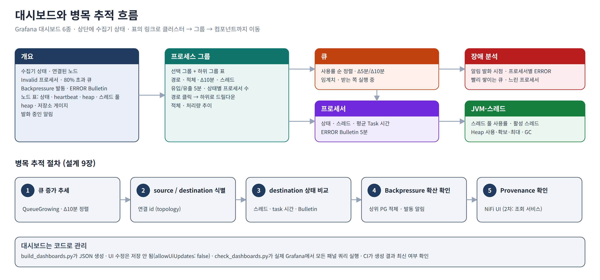

### 화면

로컬 검증 스택에서 테스트 플로우를 돌린 상태입니다.

**개요**

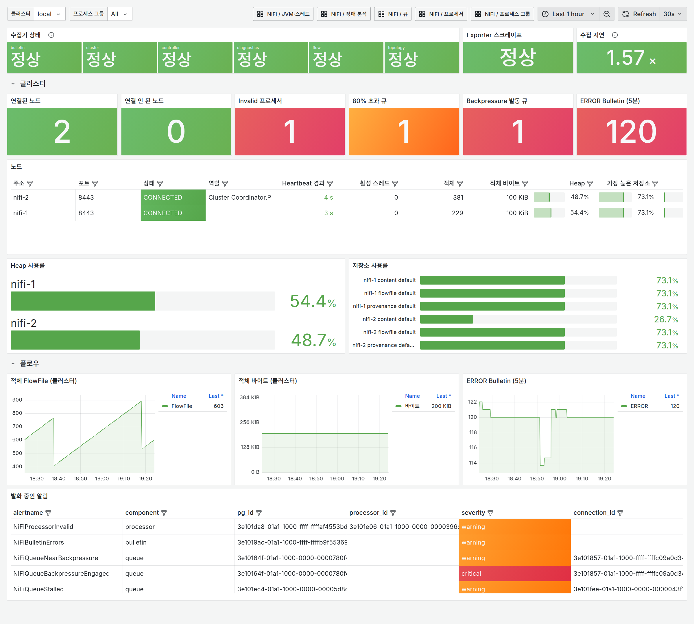

**큐**

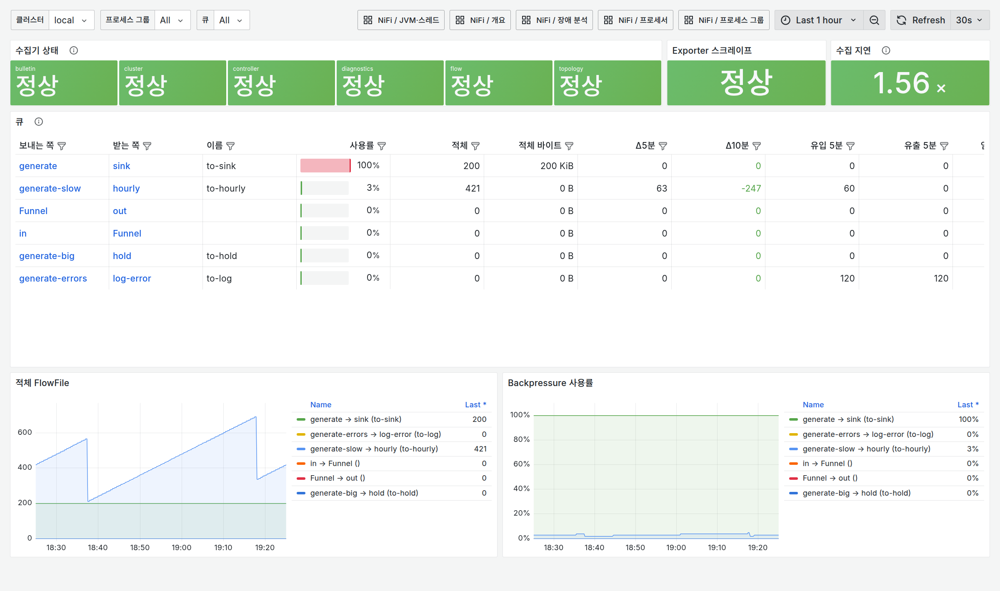

**프로세서**

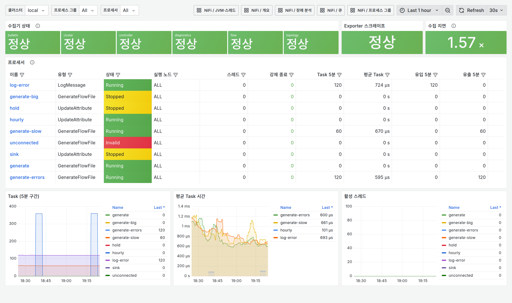

**프로세스 그룹**

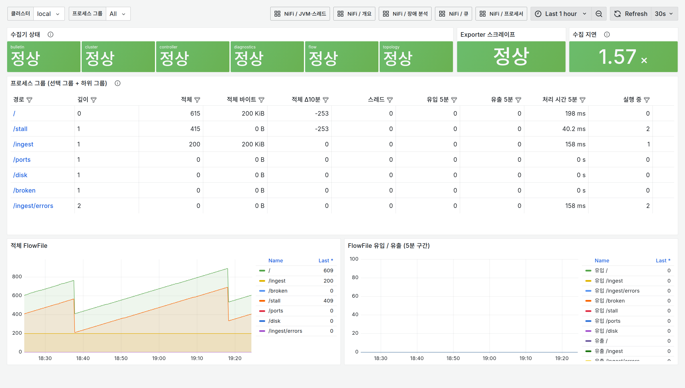

**장애 분석** — 빨간 점선은 알림 발화 시점

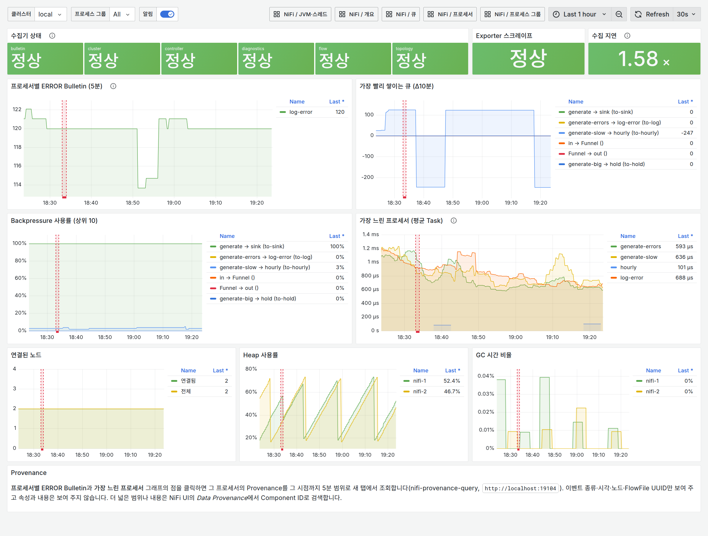

**JVM·스레드** — 노드별 스레드 풀 사용률과 heap(사용·확보·최대), GC, JVM 스레드

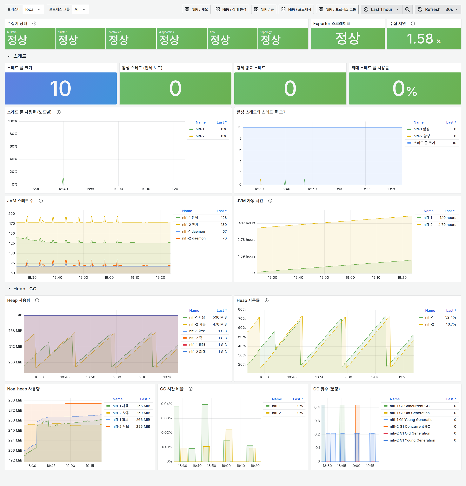

**Alertmanager** — 수신처별 그룹. 억제된 알림은 기본 목록에 나오지 않습니다

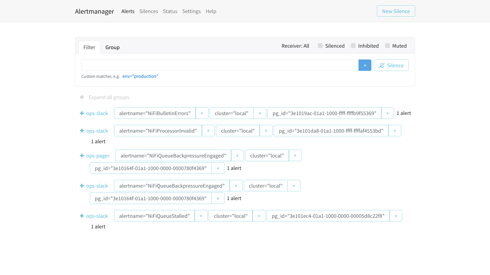

**같은 시점의 NiFi UI** — 대시보드 값과 NiFi 화면의 대응

| NiFi 화면 | 대응하는 대시보드·알림 |
|---|---|
| 캔버스(루트): Process Group별 적체·실행·정지·Invalid 수 | 프로세스 그룹 |
| `ingest` 그룹: `to-sink` 큐가 Backpressure 임계치(빨간색), 하류 `sink` 정지 | 큐, `NiFiQueueBackpressureEngaged` |
| Summary: Processor별 상태·5분 처리량 (`unconnected`는 Invalid) | 프로세서, `NiFiProcessorInvalid` |
| Bulletin Board: 두 노드에서 5초마다 나오는 ERROR | `nifi_bulletins_total`, `NiFiBulletinErrors` |
| Cluster: 노드 상태·heartbeat·노드별 적체 | 개요의 노드 표, `NiFiNodeDisconnected` |

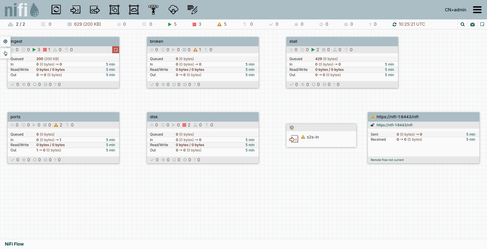

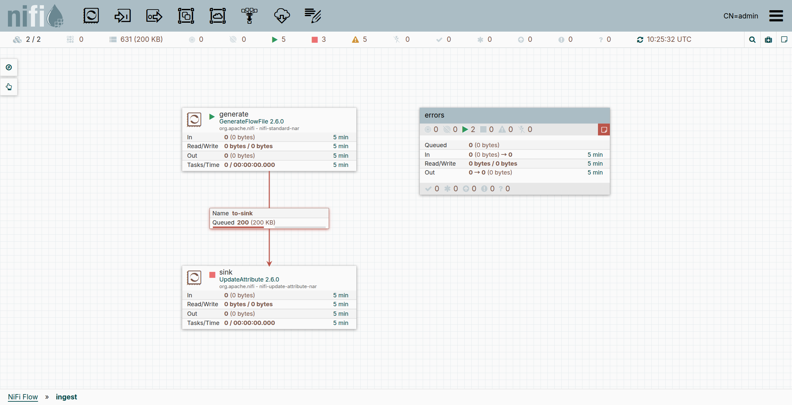

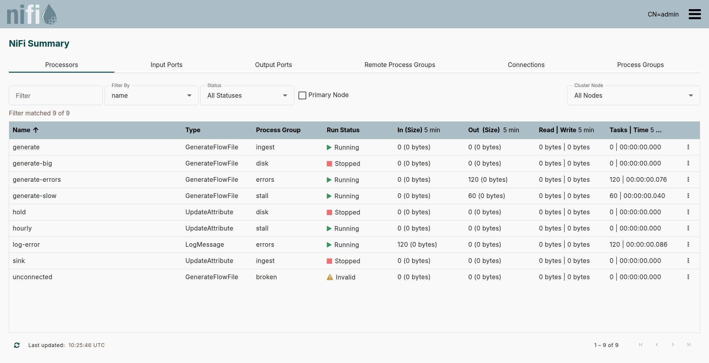

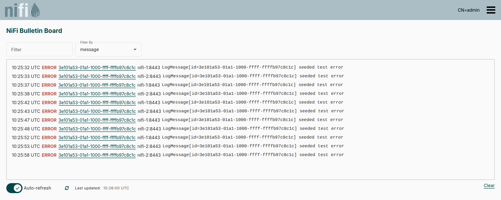

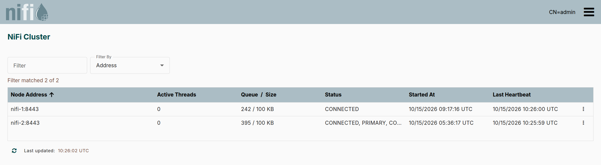

## 9. 운영

### 9.1 알림 대응

알림별 확인 위치와 조치는 [docs/runbook.md](docs/runbook.md)에 있습니다. 원칙:

1. 수집 알림(`NiFiExporterDown`, `NiFiCollectorFailing`)부터 해결합니다. 이 알림이 떠 있는 동안 NiFi 알림은 억제되고 대시보드 값은 미수집입니다.
2. 노드 알림이 그다음입니다. 노드 단절 중의 큐 적체는 결과일 가능성이 높습니다.
3. 큐 알림은 큐 대시보드 → 하류 프로세서 → Bulletin → (필요 시) Provenance 순서로 원인을 좁힙니다. Provenance는 장애 분석 그래프의 점을 클릭해 조회하고, 속성·내용이나 더 넓은 범위는 NiFi UI의 *Data Provenance*에서 봅니다.
4. Prometheus를 재시작하면 `for` 상태가 복원되는 동안 알림이 잠시 해소됐다가 다시 발화할 수 있습니다.

### 9.2 exporter 가용성

클러스터당 1개만 운영합니다. 같은 클러스터에 exporter 2개가 스크레이프되면 모든 `*_info` 시계열이 중복되어 `group_left` 조인이 실패하고, 큐·Processor·Bulletin 알림이 동작하지 않습니다(`NiFiExporterDuplicate`가 발화). 장애 시에는 재시작으로 복구하며, 그동안은 `NiFiExporterDown`이 알립니다.

### 9.3 보안

- NiFi 계정은 읽기 전용([4.1](#41-nifi-계정과-권한)). 운영 환경은 mTLS를 권장합니다.
- TLS·인증이 없는 NiFi(HTTP)는 누구나 플로우를 읽고 바꿀 수 있습니다. exporter는 그런 NiFi도 수집하지만(`auth.mode: none`), 신뢰할 수 있는 내부망에서만 운영합니다.
- `/metrics`에는 큐·Processor 이름이 노출됩니다. `server.basic_auth`를 켜거나 내부망으로 제한합니다.
- 내장 메트릭 엔드포인트는 `/flow` 읽기 권한만으로 모든 컴포넌트 이름을 노출합니다. Prometheus용 인증서도 같은 수준으로 관리합니다.
- Provenance 조회 서비스는 FlowFile UUID·Transit URI 같은 이벤트 메타데이터를 보여 줍니다. 조회용 계정은 exporter 계정과 분리하고, 서비스는 `server.basic_auth`를 켜거나 운영자 망으로 제한합니다. 조회마다 Processor·범위·건수·요청 주소를 JSON 로그로 남깁니다.

### 9.4 NiFi 업그레이드

1. 새 버전 클러스터에서 API 응답을 수집합니다.

   ```bash
   python3 deploy/local/capture_samples.py --url https://<node>:8443 \
     --cert-dir <ca.pem과 클라이언트 인증서가 있는 디렉터리> --out design/samples/<version>
   diff -r design/samples design/samples/<version>     # 필드 변경 확인
   ```

   TLS 없는 NiFi는 `--url http://<node>:8080`으로 인증서 없이 받습니다. 단일 노드는 `/controller/cluster`(404)를 건너뜁니다.

   운영 클러스터의 응답은 저장소 밖에 받은 뒤 `deploy/local/mask_samples.py`로 컴포넌트 이름·Processor 설정·호스트를 지우고 `design/samples/<이름>/`에 넣습니다. 원본은 커밋하지 않습니다.

2. 샘플을 교체하고 `cd exporter && make test`를 실행합니다. `tests/test_samples.py`가 모든 컴포넌트가 메트릭이 되는지 확인합니다.
3. 내장 메트릭 이름이 바뀌었으면 `prometheus.yml`의 allowlist와 builtin recording rule을 수정합니다.
4. 로컬 스택의 NiFi 이미지 버전을 올리고 `compare.py`, `scenarios.py`, `deploy/grafana/check_dashboards.py`, `deploy/grafana/check_drilldown.py`(Provenance 조회 포함)를 실행합니다.

### 9.5 규모 산정

컴포넌트당 exporter 시계열은 Processor 17, Connection 12, Process Group 15, 노드 39개입니다(2.6.0 실측).

| 예시 (Processor 2,000 · Connection 3,000 · PG 300 · 노드 3) | 값 |
|---|---|
| 시계열 | 약 107k (exporter 75k + recording rule 32k). 내장 엔드포인트를 켜면 +175k |
| 디스크 | 15일 약 19GB, 30일 약 38GB (내장 엔드포인트 포함 시 약 37GB / 74GB) |
| NiFi 호출 | 30초당 약 7회(cluster 15초마다 1회, flow·diagnostics·bulletin 30초마다 1회씩, controller 30초마다 2회) + 5분마다 Process Group 수만큼 |

flow 응답이 10MB를 넘으면 `collectors.flow.interval`을 60s로 늘리거나 `exclude_pg_ids`를 씁니다.

## 10. 개발과 테스트

```bash
# exporter
cd exporter && make venv install && make lint && make test

# Prometheus 규칙 (promtool)
cd deploy/prometheus && promtool check rules rules/*.yml && promtool test rules tests/*_test.yml

# Alertmanager
cd deploy/alertmanager && amtool check-config alertmanager.yml

# Grafana 대시보드 재생성 / 최신 여부 / 실제 Grafana에서 쿼리 검사
python3 deploy/grafana/build_dashboards.py
python3 deploy/grafana/build_dashboards.py --check
python3 deploy/grafana/check_dashboards.py            # 로컬 스택 실행 중
python3 deploy/grafana/check_drilldown.py             # 링크 클릭과 Provenance 조회 (Node 22, Chromium)

# 로컬 스택에서 수치 대조와 장애 시나리오
cd deploy/local && python3 compare.py && python3 scenarios.py
```

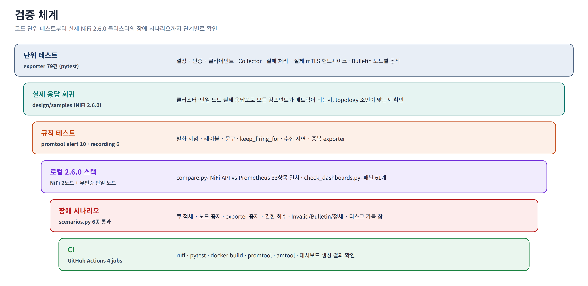

| 검증 | 내용 |
|---|---|
| exporter 단위 테스트 (114건) | 설정(HTTP·인증 없음 포함), 인증, 클라이언트, collector, 단일 노드 인식, 실패 처리와 재시도, 실제 mTLS 핸드셰이크, Bulletin 노드별 동작, Provenance 조회(요청 검증, 폴링·삭제, 타임아웃, 권한 오류, 동시 조회 제한), 알림 중계(설정 검증, 템플릿, 필터, group 모드, 재시도, 중복 방지, HTTP) |
| 실제 응답 회귀 | 9.4의 방법으로 `design/samples/`에 수집한 응답으로 모든 컴포넌트가 메트릭이 되는지 확인 (샘플이 없으면 건너뜀) |
| promtool | alert 12건, recording 7건 |
| 수치 대조 | NiFi API와 Prometheus: 로컬 33항목, CFM 392항목 (`compare.py`) |
| 장애 시나리오 | 큐 적체, 노드 중지, exporter 중지, 권한 회수, Invalid·Bulletin·정체, 디스크 가득 참 |
| 링크 클릭 | 표 셀 링크 6개의 이동 결과와 Provenance 링크 3개의 주소·조회 결과 (Grafana 11.6.0) |
| CI | GitHub Actions: ruff, pytest, docker build, 스크립트 실행 묶음 빌드·smoke test, promtool, amtool, 대시보드 생성 결과 확인 |

문서 그림과 화면 캡처:

```bash
python3 docs/diagrams/build.py                                   # docs/images/*.png
cd deploy/local && docker compose --profile screenshots up -d nifi-ui-proxy
cd ../.. && python3 docs/diagrams/screenshots.py                 # docs/images/screenshots/
```

둘 다 headless Chromium을 쓰고, 화면 캡처에는 Node 22 이상이 필요합니다. NiFi UI는 클라이언트 인증서가 필요하므로 캡처할 때만 관리자 인증서를 대신 제시하는 프록시(`nifi-ui-proxy`, 127.0.0.1 전용)를 실행합니다.

## 11. 저장소 구조와 관련 문서

```text
nifi-monitoring/
├── exporter/                 nifi-exporter, nifi-provenance-query, nifi-alert-relay (Python 3.9+, Dockerfile, 테스트)
├── deploy/
│   ├── prometheus/           스크레이프 설정, recording·alert 규칙, promtool 테스트
│   ├── alertmanager/         라우팅·억제 설정, Slack 템플릿
│   ├── grafana/              대시보드 생성기, 대시보드 JSON, provisioning
│   ├── local/                로컬 검증 스택과 검증 스크립트
│   └── cfm/                  대상 CFM 클러스터용 구성 (주소는 .env, 커밋 안 함)
├── docs/
│   ├── runbook.md            알림별 대응 절차
│   ├── images/               문서 그림, screenshots/ 화면
│   └── diagrams/             그림 생성기(build.py), 화면 캡처(screenshots.py, cdp.mjs)
├── INSTALL.md                Docker 없는 단계별 설치 가이드
├── LICENSE, NOTICE           Apache License 2.0, 저작권 고지
└── .github/workflows/ci.yml  CI
```

| 문서 | 내용 |
|---|---|
| [INSTALL.md](INSTALL.md) | Docker 없는 단계별 설치·설정 가이드 (초보자용) |
| [exporter/README.md](exporter/README.md) | exporter 메트릭·동작 상세 |
| [deploy/grafana/README.md](deploy/grafana/README.md) | 대시보드 관리 방법 |
| [deploy/local/README.md](deploy/local/README.md) | 로컬 검증 스택과 테스트 플로우 |
| [docs/runbook.md](docs/runbook.md) | 알림 대응 절차 |

## 12. 라이선스

[Apache License 2.0](LICENSE). 저작권 고지는 [NOTICE](NOTICE)에 있습니다.
